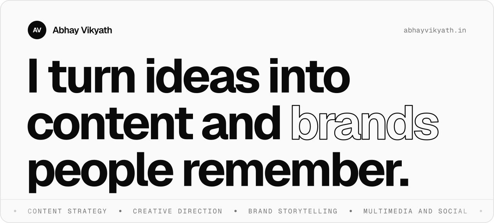

<a href="https://abhayvikyath.in"><picture><source media="(prefers-color-scheme: dark)" srcset="assets/header-dark.svg"></picture></a>

<table>
<tr>
<td rowspan="2" width="424" valign="top">
<samp>ABOUT</samp> 
I'm <b>Abhay Vikyath</b>, a Content &amp; Creative Strategist.
  
I lead content strategy, creative direction and brand storytelling across social, community and events, backed by hands-on UI/UX design and web development. I like taking an idea from concept to execution myself.
</td>
<td width="211" valign="top"><samp>BASED IN</samp> <b>Bengaluru, India</b> IST, UTC+5:30</td>
<td width="211" valign="top"><samp>OPEN TO</samp> <b>Freelance, consulting</b> Worldwide, remote</td>
</tr>
<tr>
<td valign="top"><samp>CURRENTLY</samp> <b>Multimedia Manager</b> at The Bengaluru Marketing Company</td>
<td valign="top"><samp>FOUNDER OF</samp> <b><a href="https://flipstudio.in">Flip Studio</a></b> design, video, community</td>
</tr>
</table>

 

<samp>WHAT I WORK WITH</samp>

<!-- stack:start -->
<table>
<tr>
<td width="150" valign="top"><b>Content and strategy</b></td>
<td>
<picture><source media="(prefers-color-scheme: dark)" srcset="assets/chips/dark/claude.svg"></picture>
<picture><source media="(prefers-color-scheme: dark)" srcset="assets/chips/dark/notion.svg"></picture>
<picture><source media="(prefers-color-scheme: dark)" srcset="assets/chips/dark/google-analytics.svg"></picture>
<picture><source media="(prefers-color-scheme: dark)" srcset="assets/chips/dark/meta.svg"></picture>
<picture><source media="(prefers-color-scheme: dark)" srcset="assets/chips/dark/youtube.svg"></picture>
<picture><source media="(prefers-color-scheme: dark)" srcset="assets/chips/dark/instagram.svg"></picture>
</td>
</tr>
<tr>
<td width="150" valign="top"><b>Design and video</b></td>
<td>
<picture><source media="(prefers-color-scheme: dark)" srcset="assets/chips/dark/figma.svg"></picture>
<picture><source media="(prefers-color-scheme: dark)" srcset="assets/chips/dark/canva.svg"></picture>
<picture><source media="(prefers-color-scheme: dark)" srcset="assets/chips/dark/photoshop.svg"></picture>
<picture><source media="(prefers-color-scheme: dark)" srcset="assets/chips/dark/premiere-pro.svg"></picture>
<picture><source media="(prefers-color-scheme: dark)" srcset="assets/chips/dark/after-effects.svg"></picture>
<picture><source media="(prefers-color-scheme: dark)" srcset="assets/chips/dark/framer.svg"></picture>
<picture><source media="(prefers-color-scheme: dark)" srcset="assets/chips/dark/blender.svg"></picture>
</td>
</tr>
<tr>
<td width="150" valign="top"><b>Web</b></td>
<td>
<picture><source media="(prefers-color-scheme: dark)" srcset="assets/chips/dark/html5.svg"></picture>
<picture><source media="(prefers-color-scheme: dark)" srcset="assets/chips/dark/css.svg"></picture>
<picture><source media="(prefers-color-scheme: dark)" srcset="assets/chips/dark/javascript.svg"></picture>
<picture><source media="(prefers-color-scheme: dark)" srcset="assets/chips/dark/typescript.svg"></picture>
<picture><source media="(prefers-color-scheme: dark)" srcset="assets/chips/dark/react.svg"></picture>
<picture><source media="(prefers-color-scheme: dark)" srcset="assets/chips/dark/next-js.svg"></picture>
<picture><source media="(prefers-color-scheme: dark)" srcset="assets/chips/dark/tailwind-css.svg"></picture>
<picture><source media="(prefers-color-scheme: dark)" srcset="assets/chips/dark/vite.svg"></picture>
<picture><source media="(prefers-color-scheme: dark)" srcset="assets/chips/dark/gsap.svg"></picture>
<picture><source media="(prefers-color-scheme: dark)" srcset="assets/chips/dark/wordpress.svg"></picture>
</td>
</tr>
<tr>
<td width="150" valign="top"><b>Backend and data</b></td>
<td>
<picture><source media="(prefers-color-scheme: dark)" srcset="assets/chips/dark/node-js.svg"></picture>
<picture><source media="(prefers-color-scheme: dark)" srcset="assets/chips/dark/express.svg"></picture>
<picture><source media="(prefers-color-scheme: dark)" srcset="assets/chips/dark/bun.svg"></picture>
<picture><source media="(prefers-color-scheme: dark)" srcset="assets/chips/dark/payload-cms.svg"></picture>
<picture><source media="(prefers-color-scheme: dark)" srcset="assets/chips/dark/postgresql.svg"></picture>
<picture><source media="(prefers-color-scheme: dark)" srcset="assets/chips/dark/python.svg"></picture>
<picture><source media="(prefers-color-scheme: dark)" srcset="assets/chips/dark/csharp.svg"></picture>
</td>
</tr>
<tr>
<td width="150" valign="top"><b>Shipping</b></td>
<td>
<picture><source media="(prefers-color-scheme: dark)" srcset="assets/chips/dark/vercel.svg"></picture>
<picture><source media="(prefers-color-scheme: dark)" srcset="assets/chips/dark/cloudflare.svg"></picture>
<picture><source media="(prefers-color-scheme: dark)" srcset="assets/chips/dark/github.svg"></picture>
<picture><source media="(prefers-color-scheme: dark)" srcset="assets/chips/dark/git.svg"></picture>
<picture><source media="(prefers-color-scheme: dark)" srcset="assets/chips/dark/playwright.svg"></picture>
<picture><source media="(prefers-color-scheme: dark)" srcset="assets/chips/dark/vitest.svg"></picture>
</td>
</tr>
</table>
<!-- stack:end -->

 

<samp>FIND ME</samp>

<table>
<tr>
<td width="212" valign="top"><samp>PORTFOLIO</samp> <b><a href="https://abhayvikyath.in">abhayvikyath.in</a></b></td>
<td width="212" valign="top"><samp>WORK</samp> <b><a href="https://work.abhayvikyath.in">Selected work</a></b></td>
<td width="212" valign="top"><samp>WRITING</samp> <b><a href="https://journal.abhayvikyath.in/blog">Journal</a></b></td>
<td width="212" valign="top"><samp>CHAT</samp> <b><a href="https://discord.com/invite/fkQgY5uphG">Discord</a></b></td>
</tr>
<tr>
<td valign="top"><samp>LINKEDIN</samp> <b><a href="https://www.linkedin.com/in/abhayvikyath/">abhayvikyath</a></b></td>
<td valign="top"><samp>X</samp> <b><a href="https://x.com/abhay_vikyath">@abhay_vikyath</a></b></td>
<td valign="top"><samp>YOUTUBE</samp> <b><a href="https://www.youtube.com/@flipstudio">@flipstudio</a></b></td>
<td valign="top"><samp>EMAIL</samp> <b><a href="mailto:workswithabhay@gmail.com">workswithabhay</a></b></td>
</tr>
</table>

<picture><source media="(prefers-color-scheme: dark)" srcset="assets/footer-dark.svg"></picture>
